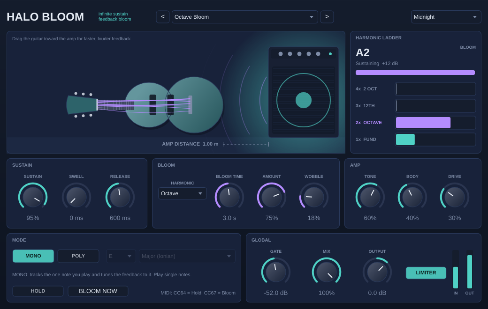

# Halo Bloom

An infinite sustainer and amp-feedback simulator for guitar (VST3, AU on macOS, and a
standalone app for live guitar through an audio interface). Notes swell in without the
pick, hold for as long as you like, then "bloom" up into the octave, 12th or two octaves
as the simulated feedback takes over, like holding the guitar up to a loud amp or using
an infinite-sustain device. Mono mode tracks single notes; Poly mode rings out chords on a
comb bank tuned to a key and scale. See `docs/DESIGN.md`.



## Build

```
cmake -B build -DCMAKE_BUILD_TYPE=Release            # fetches JUCE 8.0.4
# or: cmake -B build -DJUCE_DIR=/path/to/JUCE
cmake --build build --config Release
ctest --test-dir build                                # engine tests
```

macOS builds target macOS 11+ universal (Intel + Apple Silicon). No AVX2 or other
`-march` flags are used; the DSP is scalar C++. Windows builds use the static runtime.
GitHub Actions builds macOS (.pkg) and Windows (Setup.exe) installers on every push, and
publishes both to a GitHub Release when a `v*` tag is pushed.

Screenshots: `cmake -B build -DHALO_BUILD_SNAPSHOTS=ON`, build `halo_snapshots`, then
`xvfb-run -a build/halo_snapshots_artefacts/Release/halo_snapshots shots` on Linux.

Layout: `Source/engine` is plain C++ (YIN pitch tracker shared with Comma, sustainer,
feedback loop, bloom filters, Poly comb bank, scales, presets) with tests in `tests/`.
`Source/plugin` is the JUCE wrapper, UI and themes.
