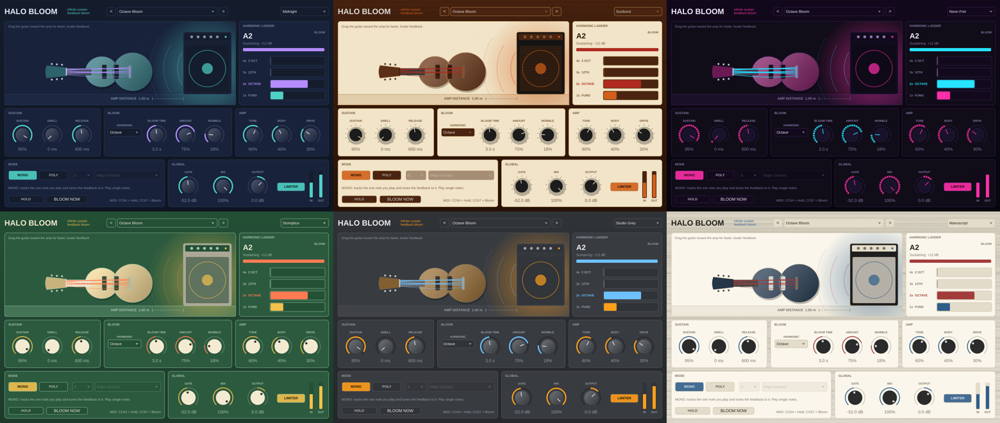

# Halo Bloom: infinite sustainer and feedback simulator (design, v0.1)

Stack: JUCE 8.0.4, C++17, CMake, VST3 + AU (macOS) + Standalone, the same layout as Comma
and Driftglass (JUCE-free engine with its own tests, thin plugin wrapper). Scalar DSP only,
so it runs on macOS 11 Intel machines without AVX2. Zero latency.

Family: guitar and performance. Pairs with Comma (put Halo Bloom first: steady sustained
notes give the harmonizer clean input), Fretwire (track Halo Bloom's output for synth
swells) and Touchstorm.

## Signal flow

```
guitar -> envelope followers (gate, pick, mute) -> note state machine
       -> YIN tracker (Mono) ------------------------------+ period
       -> sustainer (upward compressor) -> swell envelope   v
             -> Mono: feedback loop tuned to the period  /  Poly: comb bank on the key + scale
             -> blend (more loop as the note blooms)
             -> bloom: partial 2x / 3x / 4x grows out of the note (band-pass or comb, normalised)
             -> amp: drive, tone, body resonance, loudness by distance
       -> mix with dry -> output -> limiter
```

- **Note state machine** (every 32 samples): a note starts when the input crosses the Gate
  or a new pick is detected (fast envelope 8 dB over the slow one). A **mute** is a fast
  drop (20+ dB inside the slow envelope's window): it releases the note. A natural decay is
  slow, so it never looks like a mute. When the input falls below the Gate the note either
  releases or, at Infinite sustain or with Hold, **latches**.
- **Sustainer:** an upward compressor driven by a 1 ms / 40 ms envelope. Sustain is the
  exponent of the gain toward the target level, so 0% leaves the guitar alone, 50% is a
  2:1 upward compressor, and 100% holds a constant level (up to 60 dB of lift).
- **Pitch tracking:** Comma's YIN tracker (low-passed and decimated, 60 Hz to 1.4 kHz, a new
  reading every ~4 ms). Hammer-ons and slides are accepted after two agreeing frames;
  vibrato and bends are followed.
- **Feedback loop (Mono):** a Karplus-style loop (Hermite fractional delay, one-pole damping
  set by Tone, DC blocker, tanh saturator and a hard ceiling at -0.2 dBFS inside the loop)
  tuned to the tracked period, with the damping filter's phase delay compensated. Its gain
  rises with bloom progress and amp proximity. Once latched the input is cut and the loop
  gain goes above 1, so the loop self-oscillates and the saturator holds the level: the
  note rings forever at the pitch you played.
- **Bloom:** over Bloom Time (scaled 0.5x to 2x by Amp Distance) energy crossfades from the
  fundamental to the chosen partial. Mono: rectification (even partials) and saturation (odd
  partials) of the note, two cascaded band-pass filters at N x f0, normalised to the note's
  level. Poly: a second comb bank tuned N times higher. **Auto** picks whichever of 2x, 3x
  and 4x is strongest in your playing 150 ms after the pick, like real feedback locking onto
  what the strings favour.
- **Wobble:** a 5.3 Hz sine plus smoothed random flutter on the loop pitch (up to 15 cents)
  and on the harmonic's level, growing with the bloom.
- **Poly mode:** no tracking. Up to 12 scale degrees (spread evenly over larger scales) as
  combs folded into E2..E3, so each comb also rings at the higher octaves of its note. Same
  scale list as Comma (40 scales: 12-TET modes, just intonation, EDOs, maqam and more).
- **Amp:** tanh drive (level-compensated), 70 Hz high-pass, tone low-pass 1.2 to 13 kHz, body
  resonances at 105 Hz and 235 Hz, +3 dB close to the amp and -4 dB far away.
- **Limiter:** peak limiter with instant attack and 80 ms release, ceiling -0.5 dBFS, plus a
  hard clamp. The loop's own ceiling is always on, so even with the output limiter off the
  feedback can never run away.

## Controls

| Section | Controls |
|---|---|
| Sustain | Sustain (0% to Infinite), Swell (0 to 2 s fade-in, removes the pick), Release (10 ms to 4 s) |
| Bloom | Harmonic (Fundamental / Octave / 12th / 2 Octaves / Auto), Bloom Time (0.2 to 15 s), Amount, Wobble |
| Amp | Amp Distance (drag the guitar in the scene, 0.1 to 4 m), Tone, Body, Drive |
| Mode | Mono / Poly, Key + Scale (Poly), Hold, Bloom Now |
| Global | Gate, Mix, Output, Limiter |

**Stopping an infinite note:** pick a new note to move on, or tap the muted strings (a
transient with no pitch ends a latched note). Letting go of Hold, or turning Sustain below
Infinite, also releases it.

**MIDI footswitch:** CC64 (sustain pedal) = Hold, CC67 (soft pedal) = Bloom Now. Hold is
also an automatable parameter and a button.

## UI

A guitar on the left facing a glowing amp on the right. Dragging the guitar (or the mouse
wheel over the scene) sets Amp Distance; the floor ruler shows it in metres. Strings vibrate
with the output and light up as the note blooms; the amp glows and sends sound rings back
toward the guitar. The **Harmonic Ladder** shows the note, the sustainer's lift or
"Latched", a bloom progress bar, and the energy on partials 1x to 4x with the chosen one
highlighted. Six themes shared with Comma: Midnight, Sunburst, Neon Fret, Stompbox, Studio
Grey, Manuscript (each changes the knob style as well as the colours), saved with the session.



## Presets (22)

Sustain: Infinite Hold, Bow Swell, Clean Cello, Violin Lead, Long Natural, Sostenuto Pad.
Bloom: Octave Bloom, Slow Fifth, Two Octaves Up, Auto Harmonic, Quick Flip, Whistle Bloom.
Feedback: Feedback Scream, Shoegaze Sustain, Amp Stack Howl, Unstable Valve, Distant Room.
Poly: Drone Chord, Major Shimmer, Dorian Haze, Pentatonic Ring, Just Organ.

## Tests (`tests/EngineTests.cpp`)

- Silence in gives exactly silence out, at maximum settings in both modes and for every preset.
- At maximum settings (Infinite, Hold, Bloom Now, closest amp, full drive, +12 dB output) with
  full-scale input at 44.1 to 192 kHz the output never exceeds 0 dBFS and the loop never
  exceeds 0 dBFS, including with the output limiter off.
- Sustain at 97% holds a decaying note within 6 dB over 4 s; at 0% it decays naturally.
- Infinite sustain latches when the string fades out and stays in tune (within 15 cents);
  80% sustain ends the note; Hold latches even at low Sustain.
- A fast mute stops even an infinite note.
- Octave, 12th and 2-octave blooms: the fundamental leads at first, the partial dominates
  (3x the fundamental) after the bloom.
- Swell removes the pick attack; the loop tunes within 10 cents from E2 to A5; Poly combs
  stay in E2..E3 for all 40 scales and a chord sustains; every preset is finite and audible.

## Decisions taken while building

- Amp Distance is set by dragging the guitar in the scene rather than with a separate
  slider, so the picture is the control.
- A slow natural decay never ends an infinite note; only a fast mute, a pitchless tap after
  a latch, the Hold footswitch or turning Sustain down does.
- Hold counts as Infinite sustain (it lifts the fading note fully before latching).
- Presets leave Limiter, Hold and Bloom Now alone.

## Not in v0.1

- Stereo feedback (two loops with different amp positions), a room/reverb tail.
- Polyphonic tracking (Poly mode uses a fixed comb bank instead, as planned).
- Resizable UI, user preset save/load, MIDI learn for the footswitch CCs.
